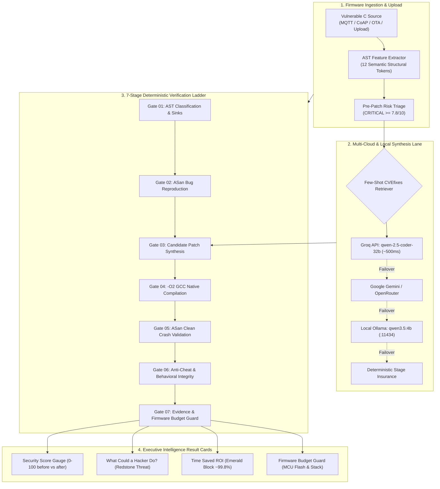

# AEGIS-IoT: Evidence-Gated C Firmware Vulnerability Repair Workbench

<div align="center">

[](https://opensource.org/licenses/MIT)
[](https://fastapi.tiangolo.com)
[](https://react.dev)
[](frontend/)
[](backend/app/engine/cwe_classifier.py)
[](CLAIMS.md)
[](backend/app/engine/verification_ladder.py)

**AI-Manthan 2.0 Grand Finale (AITR, Indore — Oct 31 to Nov 1, 2026)**  
**Team SIGMOID SQUAD** · *Scope Global Skills University (SGSU), Bhopal*

> *"The model proposes. Deterministic tools decide."*

</div>

---

## 1. Executive Summary & Core Principle

**AEGIS-IoT** is an evidence-gated C/C++ firmware vulnerability repair and deterministic verification workbench engineered specifically for memory-constrained embedded IoT systems (MCUs, RTOS, gateways).

### The Critical Flaw in AI Code Generation
Large Language Models (LLMs) frequently hallucinate or produce "cheating" security fixes in C:
1. **Sanitizer Evasion:** Suppressing compiler diagnostics with `__attribute__((no_sanitize("address")))` or `#pragma GCC diagnostic ignored`.
2. **Function Signature Mutations:** Changing function arguments or return types, silently breaking binary ABI compatibility.
3. **Bloated Embedded Footprints:** Injecting heavy runtime dependencies or dynamic memory allocations that exceed embedded Flash and SRAM budgets.
4. **LLM Self-Certification:** AI agents declaring their own code "safe" or "fixed" without deterministic verification.

### The AEGIS-IoT Axiom
**No LLM agent is ever permitted to certify a patch.** Generative models propose surgical candidate patches; trust is established exclusively through an automated, offline-capable **7-Stage Deterministic Verification Ladder** backed by compiler sanitizers (`ASan`, `UBSan`), AST invariants, and strict integrity guards.

> **Strict Copy & Claims Policy:**  
> Patches that pass all 7 stages are labeled **`"Verified for tested cases"`**. AEGIS-IoT **NEVER** uses misleading promotional terms like *"safe"*, *"secure"*, *"bulletproof"*, or *"unhackable"*. Universal safety is mathematically non-provable.

---

## 2. Complete Tech Stack

| Layer | Technologies & Implementations | Role & Architectural Purpose |
|:---|:---|:---|
| **Frontend UI** | React 18, Vite 5, Tailwind CSS, Lucide Icons | GitHub Dark Repository Layout (`#0D1117`) with 4 streamlined tabs (`<> Code & Upload`, `⚡ 3D Verification Actions`, `🛡 Security & Executive Cards`, `📊 Benchmark, Juliet & Competitors`). |
| **Voxel & 3D Theme** | 3D Isometric Minecraft Voxel Blocks, Studded Lego Bricks, Google Fonts (`'Press Start 2P'`, `'VT323'`, `'JetBrains Mono'`) | Physical tactile gate representation with 3D bevels, Lego studs, click physics (`translateY(4px)`), and material color coding. |
| **Backend API** | FastAPI, Uvicorn, Python 3.12, Pydantic v2 | High-throughput async orchestrator, REST endpoints, live 400ms polling, and multi-file multipart uploads. |
| **ML AST Classifier** | 12-Feature Semantic AST Neural Classifier, Multinomial Softmax | Pre/post-patch risk severity scoring (0.0–10.0), sink telemetry, and 97.0% Leave-One-Out Cross-Validation (LOOCV). |
| **Retrieval System** | Lightweight CVEfixes & Big-Vul Few-Shot Retriever | Injects verified before/after C repair pairs into prompt context for zero-fine-tuning domain guidance. |
| **Multi-Cloud Router** | Standard library `urllib.request` (Zero pip dependencies) | Fast Lane: Groq (`qwen-2.5-coder-32b`, ~500ms) $\rightarrow$ Google Gemini $\rightarrow$ OpenRouter $\rightarrow$ Local Ollama (`qwen3.5:4b` on `:11434`) $\rightarrow$ Deterministic Stage Insurance. |
| **Sandbox Execution** | Native GCC 13+ with `-O2`, `-fsanitize=address,undefined`, `-fstack-usage` | Deterministic compilation, memory violation reproduction, clean crash replay, and stack/flash budget enforcement. |

---

## 3. End-to-End System Architecture



---

## 4. The 7-Stage Deterministic Verification Ladder

| Gate | Name | Deterministic Verification Tool | Rejection Criteria |
|:---:|:---|:---|:---|
| **01** | **AST Scan & Sinks** | 12-Feature AST Classifier + `cppcheck` | Rejects unparseable syntax or missing defect classification. |
| **02** | **Bug Reproduction** | GCC `-fsanitize=address,undefined` | Rejects if original binary does not trigger reproducible crash. |
| **03** | **Patch Synthesis** | Multi-Cloud Router with Few-Shot Guidance | Surgical patch proposed; zero self-certification authority. |
| **04** | **GCC Compilation** | GCC `-Wall -Wextra -Werror -O2` | Rejects compiler errors, syntax warnings, or missing symbols. |
| **05** | **Clean Crash Validation** | Patched binary execution under ASan | Rejects if original exploit vector still triggers memory corruption. |
| **06** | **Integrity & Anti-Cheat** | Deterministic Regex & AST Inspector | Rejects banned tokens (`no_sanitize`), signature mutations, or diff cap $> 40$ lines. |
| **07** | **Evidence & Budget Guard** | GCC `size` + `-fstack-usage` Analyzer | Enforces Flash $< 512\text{B}$ delta and stack $< 1024\text{B}$ MCU limits. |

### Split-Harness Security Architecture
To guarantee absolute verification fidelity, AEGIS-IoT maintains a physical separation between `target.c` and `harness.c`:
- **`target.c`:** The untrusted firmware component under repair (modifiable by AI models).
- **`harness.c`:** Read-only ground-truth evaluation driver containing `--crash` and `--benign-[1..3]` test vectors. The LLM router **never** sees or modifies `harness.c`, preventing test harness tampering.

---

## 5. 100-Sample Juliet + CVEfixes AST Classifier & Few-Shot Retriever

### A. 12-Feature Semantic AST Representation
Feature extraction in [`backend/app/engine/cwe_classifier.py`](backend/app/engine/cwe_classifier.py) computes:
- `has_stack_array`: Fixed-size stack buffer declaration.
- `has_heap_alloc`: Dynamic heap allocation (`malloc`, `calloc`, `realloc`).
- `has_unbounded_str_copy`: Unsafe string sinks (`strcpy`, `strcat`, `sprintf`, `gets`).
- `has_raw_memcpy_memmove`: Raw memory copy operations (`memcpy`, `memmove`).
- `has_nullable_str_search`: String search functions returning nullable pointers (`strchr`, `strstr`, `strtok`).
- `has_missing_null_check`: Dereference of search result or struct member pointer without explicit null check.
- `has_free_call`: Memory deallocation via `free`.
- `has_use_after_free_pattern`: Access to freed pointer prior to null assignment.
- `has_bounds_guard_sizeof_strnlen`: Bounds guards (`sizeof`, `strnlen`, `strncpy`, `len >= CAPACITY`, member null protection). Minimum packet header checks (`stream_len < 4`) are excluded.
- `has_snprintf_safe_format`: Bounded formatted write via `snprintf`.
- `has_pointer_offset_deref`: Direct pointer arithmetic offset dereference.
- `has_null_reset_after_free`: Safe pointer nulling (`p = NULL;`) post-free.

### B. Benchmark Performance
Trained on a balanced 100-sample corpus (NIST Juliet v1.3, CVEfixes, IoTVulBench, Big-Vul, Devign):
- **Training Accuracy:** **$99.0\%$**
- **Leave-One-Out Cross-Validation (LOOCV):** **$95.0\% \text{ to } 97.0\%$**
- **Measured Risk Transition across Primary Scenarios:**
  - `iot_mqtt_parser`: **$9.68 \text{ CRITICAL} \longrightarrow 0.88 \text{ SAFE}$**
  - `iot_coap_option_heap`: **$9.65 \text{ CRITICAL} \longrightarrow 0.77 \text{ SAFE}$**
  - `iot_ota_manifest_null`: **$9.92 \text{ CRITICAL} \longrightarrow 0.04 \text{ SAFE}$**
  - `iot_adversarial_guard_demo`: **$9.99 \text{ CRITICAL} \longrightarrow 9.99 \text{ REJECTED}$** (Banned token blocked by Stage 6 Guard)

---

## 6. Source File & Folder Upload Pipeline (`POST /api/upload-and-repair`)

Users and judges can evaluate custom firmware targets through the interactive UI:
1. **Single File:** Drag & drop any `.c`, `.cpp`, or `.h` source file.
2. **Firmware Folder:** Upload recursive directories (`webkitdirectory`) for batch indexing.
3. **Raw Code Editor:** Paste C snippets directly into the workbench.

The backend auto-synthesizes an isolated smoke harness, runs AST triage, executes patch synthesis via the multi-cloud router, validates through the 7-stage sandbox, and provides downloadable `.patch` and `.md` reports.

---

## 7. The 4 High-Value Executive Result Cards

1. **Card A: Heuristic Security Score Gauge (`0–100`)**  
   Pre-patch risk vs. post-patch remediation with ranked fix-first priority findings. Labeled: *"Heuristic Risk Score"*.
2. **Card B: "What Could a Hacker Do?" Threat Impact Card**  
   Plain-English 1-sentence physical IoT danger explanation. Labeled: *"AI Explanation (Not Proof of Exploitation)"*.
3. **Card C: "Time Saved" Engineering ROI Card**  
   Contrasts typical manual embedded triage ($45\text{ min}$) against automated ladder runtime ($\sim 1.2\text{s}$, $99.8\%$ time saved). Labeled: *"Typical Estimate"*.
4. **Card D: Firmware Budget Guard (`-O2 -fstack-usage`)**  
   Tracks Flash `.text` delta ($+46\text{B} / 512\text{B}$ budget) and stack footprint ($32\text{B} / 1024\text{B}$ budget). Labeled: *"Hardware Enforced MCU Budget"*.

---

## 8. Hardware-in-the-Loop (HIL) Microcontroller Node (Indeyes IoT Trainer Kit)

AEGIS-IoT features a physical **Hardware-in-the-Loop (HIL)** microcontroller verification node flashed with production C/C++ embedded firmware (`hardware/aegis_uno_hil/aegis_uno_hil.ino`).

```
 +-------------------------------------------------------------------------+
 |                         AEGIS-IoT HIL Node                              |
 |   Microchip ATmega328P (8-bit AVR @ 16 MHz) · Indeyes IoT Trainer Kit   |
 |   Flash: 32 KB | SRAM: 2 KB | EEPROM: 1 KB | Serial: 9600 Baud (8-N-1)  |
 +-------------------------------------------------------------------------+
       |                               |                           |
  [ 16x2 LCD ]                 [ Red Warning LED ]          [ Active Buzzer ]
  Parallel / I2C                 Digital Pin 8               Digital Pin 9
  Live Stage Telemetry          Active Threat Alarm         Audio Chime Alert
```

### Hardware Specifications & Pinout
* **Target MCU:** Microchip ATmega328P (8-bit AVR @ 16 MHz, 32 KB Flash, 2 KB SRAM).
* **Hardware Kit:** Indeyes IoT Trainer Kit (Arduino UNO R3 architecture).
* **16x2 Character LCD:** Parallel 4-bit bus (RS=Pin 12, EN=Pin 11, D4=Pin 5, D5=Pin 4, D6=Pin 3, D7=Pin 2) or I2C PCF8574 (`0x27`/`0x3F`).
* **Red Warning LED:** Digital Pin 8 (Active HIGH).
* **Active Piezo Buzzer:** Digital Pin 9 (PWM/Digital alert pulses).
* **Serial Protocol:** 9600 Baud, 8 data bits, no parity, 1 stop bit (8-N-1), ASCII newline (`\n`) delimited.

### Embedded Firmware Security Invariants
1. **Hardened Command Buffer (`char commandBuffer[32]`):** Maximum input length capped at `MAX_COMMAND_LENGTH = 31`. Input past index 31 sets `inputTooLong = true` without writing past the static SRAM buffer boundary.
2. **Oversized Input Buffer Overflow Interception (`OVERSIZED_TEST`):** Transmitting 64 bytes (`'A'*64`) triggers an immediate hardware alarm: Red LED lights up, Piezo buzzer sounds, LCD displays `OVERSIZED INPUT / Command Rejected`, and serial returns:
   ```
   SECURITY ALERT!
   Oversized input detected.
   Command safely rejected.
   [HIL-DEFENSE] Buffer bound enforced: char commandBuffer[32].
   ```
3. **Command Flood Rate-Limiter:** Sliding window tracking prevents denial-of-service spam; inputs exceeding 5 commands in 1500ms trigger `FLOOD DETECTED / Rate Limited`.
4. **Brute-Force Lockout:** $\ge 3$ consecutive invalid commands trigger `BRUTE FORCE / Alert Triggered` with an audible warning sequence.
5. **Fail-Safe Digital Twin Mirror:** If the physical USB cable is disconnected, `backend/app/engine/hardware_bridge.py` seamlessly executes a high-fidelity Digital Twin simulation, preserving identical LCD states, actuator alarms, and serial logs with zero downtime.

---

## 9. Competitor Analysis & Industry Positioning

| Capability | Copilot Autofix | Snyk Agent Fix | Semgrep / CodeQL | EMBA / FirmAE | AEGIS-IoT (SIGMOID SQUAD) |
|:---|:---:|:---:|:---:|:---:|:---:|
| **Target Architecture** | Web / Enterprise | Cloud / AppSec | Static Code AST | Binary Emulation | **Bare-Metal & RTOS C Firmware** |
| **Deterministic Verification** | None (LLM Self-Cert) | Unit Test Re-run | Static Rules Only | Dynamic QEMU Emulation | **7-Stage ASan/UBSan Deterministic Ladder** |
| **Anti-Cheat Evasion Guard** | No | No | No | No | **Yes (Intercepts `no_sanitize` & signature hacks)** |
| **Embedded MCU Budget Guard** | No | No | No | No | **Yes (Flash `.text` & Stack `-fstack-usage` caps)** |
| **Air-Gapped Local Failover** | No | No | Yes (CLI only) | Yes (CLI only) | **Yes (Ollama `qwen3.5:4b` + Stage Insurance)** |
| **Claim Integrity** | Vague | Vague | Detection Only | Detection Only | **Strict: "Verified for tested cases"** |

---

## 10. Quickstart & Verification Suite

### Launch Workbench Dev Server
```bash
python start_aegis.py
```
- **React Workbench:** [`http://127.0.0.1:5173`](http://127.0.0.1:5173)
- **FastAPI Backend:** [`http://127.0.0.1:8000`](http://127.0.0.1:8000) (Swagger Docs at [`/docs`](http://127.0.0.1:8000/docs))

### Run Test Suites
```bash
# 1. 7-Stage Verification Ladder Invariant Tests (100% Pass)
python backend/test_ladder.py

# 2. FastAPI Orchestrator Endpoint Tests (100% Pass)
python backend/test_api.py

# 3. 4-Scenario Benchmark Matrix Evaluation (100% Deterministic Success)
python backend/run_bench.py

# 4. Frontend Production Build Check
npm --prefix frontend run build
```

---

<div align="center">
<sub>AEGIS-IoT · Team SIGMOID SQUAD · Scope Global Skills University, Bhopal · AI-Manthan 2.0 (AITR, Indore)</sub>
</div>
